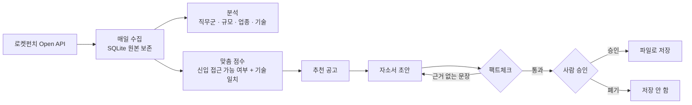

# 🧭 AI-agent: 채용 공고 데이터 기반 취업 준비 에이전트


**채용 공고를 매일 모으고, 내 기술과 맞는 공고를 골라 주고, 자소서 초안까지 써 주는 개인 취업 준비 에이전트입니다.**

의료IT 전공 신입이 IT 업계 진로를 **감이 아니라 데이터로 정하기** 위해 만들었습니다.

> 핵심 원칙: **에이전트는 초안까지만 만들고, 제출과 최종 판단은 사람이 합니다.**
> 자소서의 모든 문장은 내 프로필에 적힌 사실로만 쓰고, 근거 없는 문장은 팩트체크 단계에서 지웁니다.

---

## ✨ 할 수 있는 것

| 화면 | 하는 일 |
|---|---|
| **추천 공고** | 수집한 공고 중 신입이 지원할 수 있는 공고를 내 기술과의 일치도 순으로 보여 줌. 부족한 기술은 점수에서 깎지 않고 따로 표시 (배울 것을 정하는 용도) |
| **자소서 초안** | 공고를 고르면 초안 작성 → 팩트체크 → 사람 승인 → 파일 저장. 어디에도 제출하지 않음 |
| **지원 현황** | 관심 → 지원 준비 → 서류 제출 → 면접 → 결과 단계로 지원 상황 관리 |
| **프로필** | 초안과 분석의 근거가 되는 내 프로필(`profile.yaml`) 확인 |

---

## 🔄 동작 흐름



**자소서 에이전트 (LangGraph)**
1. 공고 평가
2. 초안 작성: 프로필의 사실과 공고 내용만 사용. 프로필에 없는 내용은 지어내지 않고 `[TODO]` 문장으로 남김
3. 팩트체크: 각 문장을 프로필과 대조해 `ok` / `todo` / `remove`로 판정. 프로필에 없는 기술을 써 본 것처럼 말하는 문장은 삭제
4. 삭제된 문장이 있으면 다시 작성 (최대 2회, 지워진 문장은 다시 만들지 않음)
5. **사람 승인에서 멈춤** (LangGraph `interrupt`). 승인해야 저장되고, 승인해도 제출하지 않음

초안 작성기는 지금 템플릿 기반입니다. 입력과 출력 형식을 고정해 두어서, 나중에 LLM으로 바꿔도 팩트체크와 승인 단계는 그대로 씁니다.

---

## 📊 진행 상황

| 단계 | 내용 | 상태 |
|---|---|---|
| 0 | 범위 · 소스 · 스키마 · 운영 설계 | ✅ 완료 |
| 1 | 공고 일일 자동 수집 (로켓펀치 Open API + SQLite) | ✅ 완료 |
| 2 | 분류 체계 설계 + 정답 세트 직접 라벨링 | 🔨 라벨링 도구 완료, 라벨링 진행 |
| 3 | 분류 자동화: 규칙 vs LLM 정확도 비교 | ⏳ 대기 |
| 4 | 직무군 · 규모 · 업종 · 기술 분석, 내 기술과의 갭 | ✅ 분석 리포트 · 맞춤 점수 완료 |
| 5 | LangGraph 취업 에이전트 + Streamlit 화면 | ✅ 1차 완성 (초안은 템플릿 기반) |
| 6 | 포트폴리오 정리 | 🔨 진행 중 |

---

## 🧱 설계 원칙

| 원칙 | 구현 |
|---|---|
| **자동 제출 금지** | 에이전트는 평가와 초안까지만. 승인 후에도 파일로만 저장 |
| **사실만 쓴다** | 자소서는 `profile.yaml`의 사실만 근거로 쓰고, 팩트체크가 근거 없는 주장을 지움 |
| **원본 보존** | API 응답 원본을 그대로 저장하고, 분석용 테이블은 원본에서 다시 만들 수 있게 분리 (마감된 공고는 API로 다시 받을 수 없기 때문) |
| **사람이 먼저, 자동화는 나중** | 분류 기준과 정답 세트를 직접 만들고, 자동 분류는 그 정답 세트로 정확도를 측정 |
| **라벨 편향 방지** | 라벨링할 때 API가 주는 직무 · 경력 분류를 일부러 숨김. 일부는 다시 라벨링해 내 일관성도 측정 |
| **한계를 명시** | 소스 · 수집 기간 · 본문 유무에 따른 한계를 분석 결과에 함께 기록 |

각 결정의 이유는 [DECISIONS.md](DECISIONS.md)에 기록했습니다.

---

## ▶️ 실행 방법

```bash
git clone https://github.com/mdkk0220/AI-agent.git
cd AI-agent
python -m venv .venv
source .venv/bin/activate          # Windows: .\.venv\Scripts\Activate.ps1
pip install -r requirements.txt
```

**1. 설정**
```bash
cp profile.example.yaml profile.yaml   # 내 정보를 "사실만" 채우기
```
`.env` 파일에 로켓펀치 API 키를 넣습니다. (커밋하지 않습니다)
```
ROCKETPUNCH_APP_KEY=발급받은_키
```

**2. 수집 · 분석 · 추천**
```bash
python -m collector.run        # 공고 수집 (하루 1회, scripts/run_daily.* 로 자동화 가능)
python -m analysis.report      # 현황 분석 → data/analysis/
python -m matching.skills      # 맞춤 점수 → data/ranked_skills.csv
python -m labeling.label       # 정답 세트 라벨링
```

**3. 화면 실행**
```bash
streamlit run app.py
```

**테스트**
```bash
pytest
```

---

## 📂 폴더 구조

```
collector/    로켓펀치 API 클라이언트, 일일 수집기, SQLite 저장
labeling/     정답 세트 라벨링 도구
analysis/     직무군 · 규모 · 업종 · 기술 분석 리포트
matching/     신입 접근 가능 여부 판정, 기술 일치 맞춤 점수
agent/        LangGraph 그래프, 초안 작성기, 팩트체크, 저장
app.py        Streamlit 화면
docs/         소스 조사, 분류 정의서, 일정, 실행 절차
scripts/      일일 실행 스크립트
tests/        단위 테스트
data/         수집 DB · 로그 · 결과 (저장소에 올리지 않음)
```

---

## 🗂️ 데이터 출처와 공개 범위

- 채용 공고 데이터: **로켓펀치 Open API** (공식 API 키 사용, 분당 60회 · 하루 5,000회 한도 준수). 사람인 채용정보 API는 이용 신청 중입니다.
- 이 프로젝트는 데이터 제공사와 제휴 관계가 없습니다.
- **공개:** 코드, 문서, 집계 통계
- **비공개:** API 키(`.env`), 수집한 공고 원본과 DB(`data/`), 개인 프로필(`profile.yaml`)
- 개인 학습 목적이며, 수집한 데이터를 재배포하거나 판매하지 않습니다.

---

## ⚠️ 한계

- 수집 기간 동안 열려 있던 공고의 스냅샷이라, 시기와 소스에 따라 결과가 달라질 수 있습니다.
- 기술 분석은 공고에 해당 기술이 **언급됐는지**를 세며, 필수 요구 조건과 같지 않습니다.
- 자소서 초안은 템플릿 기반이라 문장이 단조롭습니다. LLM 작성기로 바꿀 예정입니다.

## 🗺️ 다음 계획

- [ ] 정답 세트 100건 라벨링 완료
- [ ] 규칙 분류 vs LLM 분류 정확도 비교 (정밀도 · 재현율 · 혼동행렬)
- [ ] 초안 작성기를 LLM으로 교체 (팩트체크 · 승인 단계는 유지)
- [ ] 진로 후보 2~3개와 근거 정리
